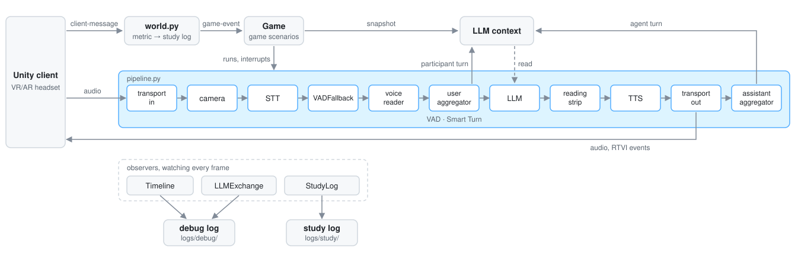

# Architecture

What the code does not say in one place: how data flows, where each configuration seam is, what the Unity client and the agent promise each other, what the logs hold, and how the benchmarks compare models. Module docstrings cover the rest.

## Data flow

A run starts by settling the session: `config.load` reads the environment, `session.resolve` takes the command line and opens the dialog for whatever is left open, and `roster` picks the session's log file. Only then does the agent start the LiveKit server, if nothing answers on its port yet, and the token endpoint the client joins through. A session on the `nemotron` STT also has `nemotron_server` bring up its NIM container through Docker Compose and waits until it is serving. The dialog already starts it when `nemotron` is selected and shows its progress next to the STT field, so this is usually only the wait. Unlike the LiveKit server, the container is left running after the session, since it takes about 40 s to start.

The pipeline runs in one direction:

```
transport in -> camera -> STT -> VADFallback -> voice reader -> reading filter -> user aggregator -> LLM -> reply strip -> TTS -> transport out -> assistant aggregator
```



`pipeline.py` is the only place it is assembled, and receives its transport, services and tools, and the camera, context capture and reading filter the session reads, rather than constructing them. The scenario's system prompt is the LLM service's `system_instruction`, set when the catalog builds the LLM, and not a message in the context; Pipecat sends it ahead of the context on every call. Turn-taking is Pipecat's default: Silero VAD starts a turn and Smart Turn v3 ends it; a transcript starts a turn the VAD missed, and Pipecat ends that turn itself. The participant is muted until the opening has finished.

`VADFallback` covers speech the VAD misses on a streaming STT. Voxtral sends a final transcript only once it is told the speech has ended, so without the fallback such a turn ends with interim transcripts only and its words never reach the LLM. When interim transcripts arrive without VAD activity and then stay quiet for 1.5 s, the fallback sends the STT that end of speech itself. Whisper transcribes only what the VAD marked as speech, so on Whisper speech the VAD misses is lost and the fallback never acts. The fallback sits before the voice reader, so the end of speech it sends reaches only the STT, and a turn the VAD missed carries no reading.

Pipecat Voice Reader (`PipecatVoiceReader`, expressive conversation) hears each user turn when the VAD reports its end, up to its last 8 s, on the CPU, and puts a reading of the voice at the head of the turn's transcription: tone of voice, arousal, laughter, speech rate and sarcasm in the voice. The transcription waits for it, at most 2 s; a turn under 0.8 s is not read. `enable_expressive_conversation` teaches the LLM to read it, with instructions Pipecat adds after the system prompt. Neither TTS voice in the catalog performs expression tags, so the LLM is taught none. The model is English-only and reads every session, German ones included.

The reading filter (`ReadingFilter`, `agent/reading_filter.py`) sits between the voice reader and the user aggregator, in every scenario, and cuts each reading down to what stands out before the LLM gets it: tone labels other than `neutral` that reach 0.7, and laughter or sarcasm whose chance reaches 0.7. Arousal and speech rate never reach the LLM, and the signals declared to it leave them out, so Pipecat's instructions do not teach them. A turn with nothing left reaches the LLM without a reading. The filter keeps the full readings of the turn, merged as the user aggregator merges what the LLM gets and leaving out speech while the participant is muted, and when the aggregator writes the turn to the context the study log gets them once as `voice_reading`.

The LLM sometimes copies a reading into its reply, or writes a tagged snapshot or input of its own. The reply strip, the `LLMTextProcessor` that `reply_strip()` in `agent/reply_strip.py` builds, sits between the LLM and the TTS. Its aggregator drops every `<game_state>`, `<held>`, `<pointing>` or `<objects>` block whole, even one spanning sentences or left unclosed at the end of the reply, and its transform `strip_readings` removes every reading from each sentence, so neither is spoken nor kept in the context or the study log's `assistant_message`. The words around them stay. The debug log warns with the block or the sentence it was found in. Other bracketed text passes unchanged.

Audio enters at 16 kHz, which Silero VAD, Smart Turn and the STT require, and leaves at 48 kHz, native for ElevenLabs and LiveKit. The transport resamples once on the way in.

Observers watch the pipeline without being part of it: `Timeline` and `LLMExchange` write the debug log, `StudyLog` the study log, `ThoughtRelay` sends the LLM's thoughts to the client, `ReferRelay` the agent's references to objects, `Inputs` (`agent/inputs.py`) keeps the participant inputs in the LLM context and sends and logs the per-call input record. `world.py` holds everything that passes between client and agent that is not audio.

A scenario with a game adds `Game` (`agent/game.py`), an observer that also queues frames. It turns each game snapshot from the client into the LLM context and decides when the agent speaks about it:

- The client sends its first snapshot once it has the `session` message. If none arrives within 5 s (`START_WAIT_S`), the debug log warns once that the agent is still waiting.
- Only the newest snapshot is in the context, swapped in place of the previous one and appended last, as a developer message holding its JSON between `<game_state>` tags (`TAG` and `wrap` in `agent/game.py`), so the LLM tells it from the participant's words. Mistral receives it as a user message.
- An event expires: 10 s after the newest snapshot (`EVENT_TIMEOUT_S`), it is swapped in again with `event` and `detail` set to null, so the agent does not take an old event for what just happened. A reaction still held keeps its event until it has run. Expiry is not a client event and appears only in the debug log's LLM contexts.
- A scenario without a greeting opens on the session's first snapshot. A scenario with a greeting opens on it and runs an intro: every snapshot enters the context, none is reacted to, and the study log labels it `intro`. The intro ends when the LLM calls `start_task`, the one tool, offered only then; its result runs the LLM again, which starts the task from the newest snapshot.
- After the opening or the intro, the scenario's reaction table decides per snapshot: `silent` updates the context and nothing more; `when_idle` runs the LLM once nobody is speaking, no reply is generating and none is waiting to be heard, after a 0.3 s grace; `interrupt` cuts the agent off and runs the LLM at once, unless the participant is speaking, when it waits like `when_idle`.
- Reactions held while the agent is busy collapse into one run. A run that starts on a context already holding the snapshot, such as the participant's own turn, settles the held reaction, so the agent does not answer the same state twice.

The agent refers to an object by marking it in its reply (`agent/nonverbal.py`). Every scenario's system prompt is followed by `INSTRUCTIONS`, which teach the LLM to write `<refer>ID</refer>` at the start of the sentence about an object, with an ID from the `<objects>`, `<held>` or `<pointing>` messages. The reply strip passes each marker on as a unit of its own between the words around it, and `Game` and `Inputs` take a reply's words and its end as the reply strip passes them on, so a reply left with nothing to speak is not waited for, and the TTS and the client's bot output leave the `refer` type out (`skip_text_types`), so it is never spoken or shown. The TTS releases the marker in step with its audio, and the output transport passes it on once the audio before it has been played out, which is when `ReferRelay` sends the `nonverbal` server-message; a marker first in the reply goes out at once. A reply interrupted before the marker sends nothing. The marker stays in the context and the study log's `assistant_message` where the LLM wrote it. The client's object list takes the route of a game snapshot: one developer message holding its JSON between `<objects>` tags, swapped in place of the previous list (`SceneObjects`), never running the LLM by itself and not part of the input record.

A participant input (`held`, `pointing`) takes the same route as a snapshot: one developer message per kind in the context, swapped in place of the previous one and wrapped in a tag named after its kind, `<held>` or `<pointing>` (`CLIENT_INPUTS` in `agent/inputs.py`). The message reads every state each hand has had since the participant last started speaking, so an object let go of just before the LLM call still counts: a hand with one state reads that object, a hand that changed reads its states in order with `null` for empty, such as `{"left": [{"id": "flask-1", ...}, null]}`, a hand that has had nothing is left out, and with no hand left the message reads `nothing` as plain text. A new description of the object a hand already holds replaces its entry. When the participant starts speaking, each hand starts over from its current state, once per turn: speech resumed before the turn's LLM call keeps the history, and any other LLM call does not start it over. A turn ends with the LLM call on its user message, so after speech that never reaches the LLM, such as a false start with an empty transcript, the next speech does not start the hands over, and that turn's history also holds the states since the false start. An input never runs the LLM by itself. `selected(kind)` in the same module decides which kinds are put into the context and passes every kind today. `ContextCapture` adds two pass-through processors, one right before the LLM and one right after it, since a call can also arrive from upstream, such as on a tool result; they copy the message list each call reads, so the input record shows the context at the moment of the call.

## Transport

LiveKit carries audio and events between the agent and Unity. Audio is a WebRTC track, so the LiveKit Unity SDK handles jitter buffering, playback and congestion control rather than client code. Turn-start stutter and late interruptions live in exactly that code. Events go through the same room as data packets, so neither side maintains its own framing, and Pipecat's `LiveKitTransport` and the LiveKit Unity SDK speak it already. LiveKit is the transport only: the agent logic is Pipecat's pipeline, and LiveKit Agents is not used.

## Configuration seams

Each choice is made in one place and reaches the command line and the dialog from there.

- Models: `agent/services/catalog.py`, name to factory, with `DEFAULTS`, the languages each voice speaks, and `LOCATIONS`, whether each entry runs `local` or in the `cloud`, which the input record reports. A factory imports its provider inside the function, so selecting one model never loads another's dependencies. Every entry names a pinned snapshot such as `mistral-small-2603`, never a `-latest` alias, so a provider cannot change the model under a running study; a retired snapshot fails at startup instead. Every Mistral LLM entry fixes its `reasoning_effort`: `none` where the model can turn reasoning off (`mistral-small`), otherwise the lowest it accepts (`low` for `mistral-large`). Mistral streams thinking as content parts; `agent/services/mistral_llm.py` turns them into Pipecat's `LLMThought*` frames, so thinking never reaches TTS or the LLM context, and passes only the answer on as text. A request that ends on a tool result goes out as it is: Pipecat's Mistral adapter would append a blank assistant reply marked as a prefix to continue, which Mistral does not need and Large 4 refuses.
- Scenario: `agent/scenarios/`, name to `Scenario`: the system prompt, an optional fixed greeting, and the reaction table for a scenario with a game. A game with a greeting opens with an intro. What a session is about varies here and nowhere else. Each scenario has its own folder, and its `README.md` describes it: persona, opening, and the game events it takes.
- Transport: `session.TRANSPORTS`. LiveKit is the only one.
- Session: participant ID, language (`config.LANGUAGES`, English or German) and `--vision`, on the command line or in the dialog; `--save-frames` (command line only, needs `--vision`) for testing the camera track.

A field with a single option is settled without asking. A command line naming the participant, the language and every field with a choice starts headless.

## Unity contract

The Unity client is a separate project. This section is what both sides hold to.

Connecting:

- Unity fetches its connection details from `POST /getToken` on port 8080, LiveKit's standard token endpoint format: a body naming `room_name`, `participant_identity` and `participant_name`, or an empty one to take the configured room and the identity `unity`. It is answered with `server_url` and `participant_token`. The LiveKit Unity SDK speaks this already.

Messages:

- Everything that is not audio or video is one reliable LiveKit data packet per message, in Pipecat's RTVI envelope: `{"label": "rtvi-ai", "type": ..., "id": ..., "data": ...}`. A reliable packet caps at 15 KiB, so anything larger than small JSON is a track or a byte stream, never a packet.
- Custom messages carry `{"t": <type>, "d": <data>}`: a `client-message` from Unity, a `server-message` from the agent.

Handshake:

- Unity sends `client-ready` naming its RTVI protocol version. Pipecat 1.16 speaks 2.3.0 and serves any 2.x client fully; a mismatched major version is answered with an error and the session continues degraded. The version is re-checked on every Pipecat upgrade.
- The agent answers with `bot-ready` and, alongside it in either order, a server-message `{"t": "session", "d": {...}}` carrying every setting of the session, the fields of `session_start` in the study log. Unity takes what it needs, such as the language for its UI, and ignores the rest.
- The agent then opens the conversation as the scenario defines: a fixed greeting spoken at once, or, for a scenario with a game and no greeting, the LLM's first run once the first snapshot arrives.

Agent to Unity, with no agent code behind them: `bot-started-speaking`, `bot-stopped-speaking`, `bot-tts-started`, `bot-tts-stopped`, `bot-tts-text` word by word, `bot-output`, `user-started-speaking`, `user-stopped-speaking`, `user-transcription`, `bot-interrupted` and `metrics`. These are the animation and interruption triggers.

Agent to Unity, from agent code: a server-message `{"t": "thought", "d": {"text": ...}}` with each LLM thought whole, sent when the thought ends, which is before the answer it led to is spoken. Only a reasoning model thinks, so a session on `mistral-small` sends none.

Agent to Unity, from agent code: a server-message `{"t": "inputs", "d": {...}}`, one record per LLM call, keyed by `id` and sent again as its state advances. `draft` is `{id, state, inputs, dropped: []}`, sent whenever what the next call is meant to get changes, and right after each call. `sent` is `{id, state, trigger, llm, inputs, dropped}`: `trigger` is `user_turn`, `tool_result`, `game` or `other`, and `llm` is `local` or `cloud`. Then `answered` or `interrupted`, as `{id, state}`. `sent`, `answered` and `interrupted` also carry `turn`, the turn the study log stamps the same record with, so a client can group a turn's calls; a draft carries none, since its call's turn is not known yet. A call belongs to the turn of its `sent` message; its outcome carries the turn it happened in, which can be later, such as when the participant's speech starts a new turn and interrupts the reply. An entry in `inputs` is `{input, data, where}`: `input` is `transcript`, `emotion`, `held`, `pointing` or `game`, and `where` is `local` or `cloud` (where the model that read it runs) or `client`. For `held` and `pointing`, `data` is what the context message read: `nothing`, or the hands as described above. `dropped` lists the inputs the call was meant to get and did not get; for `held` and `pointing` that includes a call that got other data. A transcript counts in every call that reads its user message after the last assistant or tool message, so a question whose reply was interrupted before any of it was spoken is listed again in the next call's record; a reply cut off after some of it was spoken stays in the context, and its question is not listed again. The reading at the head of a user message, as the reading filter left it, is split off as `emotion`, `where` `local`. Only an interruption makes a record `interrupted`; a reply is `answered` once it has ended and been heard, or at its end when it has no words.

Agent to Unity, from agent code: a server-message `{"t": "nonverbal", "d": {"behaviour": ..., ...}}`, one nonverbal behaviour per message, which Unity performs as soon as it arrives. `behaviour` names it and the other fields belong to that behaviour. `refer` is `{behaviour, target, look, point, duration}`: look at and point at the object whose ID is `target`; `look` and `point` default to true, and `duration`, in seconds, defaults to 3 and sets how long a look without pointing lasts, zero or less meaning until the next `refer`; a look with pointing ends shortly after the arm's peak. The agent sends `refer` with `behaviour` and `target` only, when the words before the LLM's marker have been played.

Unity to agent:

- `metric`: a measurement, written to the study log as sent, so Unity adds one without a backend change. By convention `d` carries a `name`. Unity answers each `nonverbal` server-message with the metric `{"name": "nonverbal", "behaviour", "target", "outcome"}`: `outcome` is `done`, `point_refused` (pointing was asked for and the agent cannot point there; a look asked for still happens), `target_not_found`, `unknown_behaviour` or `unavailable` (the agent cannot perform the behaviour at all).
- `objects`: the objects in the scene at the start, as a list of objects described as below, sent once the client has the `session` message, so again after every reconnect. Objects that appear later reach the agent through `held` and `pointing`. Written to the study log as sent and put into the LLM context, so the agent knows which IDs it can refer to.
- `game-event`: a full snapshot of the game's state, taken only by a scenario with a game. What `d` holds and how each event is reacted to is in that scenario's `README.md`.
- Participant inputs (`world.CLIENT_INPUTS`), each carrying that input's full current state, so on the wire only the newest of a type counts. Written to the study log as sent, and put into the LLM context, one message per type with each hand's states since the participant last started speaking. `held`: `{"left": <object>, "right": <object>}`, sent whenever a grab starts or ends or a held object changes, `null` for an empty hand. `pointing`: `{"left": <object>, "right": <object>}`, the object each hand has pointed at steadily for a moment, sent whenever either target changes or a pointed object changes, `null` for a hand that points at nothing or holds something.
- An object is described as `{"id": ..., "kind": ..., ...}`: an ID unique among the loaded objects, its kind, and whatever its scenario adds (a Lab flask adds `shape` and `substance`). An object Unity cannot refer to is `{"id": null, "kind": "unknown", "name": ...}`: named, but without an ID. The ID is how either side names an object to the other.
- Any other client-message type is logged as unhandled.

Camera: Unity publishes the participant's view as an ordinary video track named `vision`, low resolution and low frame rate, and leaves it open. `--vision` decides whether the agent subscribes. `Camera` (`agent/camera.py`), right after the transport input, keeps the newest frame as `latest` and stops every frame there, so none reaches the LLM or the aggregators; a frame passing the assistant aggregator mid-reply would commit the reply in two parts. A future input selection can put `latest` into the context. An image the pipeline itself requested passes through. With `--save-frames`, each frame is written as a PNG to `logs/frames/<session>/`, named by its arrival time.

## Logs

Raw audio is never written. Participants are identified by pseudonymous ID only.

Participant IDs: any string that can name a file. `P` and a number is the numbered form, stored with at least two digits, so `p4` becomes `P04`. The dialog suggests one past the highest number any study log has used. A participant's first session is `P04`, a re-run `P04-2`, and an existing log is never reopened. `test` is offered for trying the platform out and is never counted.

Two logs per session:

- `logs/study/<session>.jsonl`, the record the analysis reads. One JSON line per event, flushed as written, each stamped with `ts`, `iso` and the current `turn`. `session_start` names participant, session, language, scenario, transport, vision, the models by catalog name and by the provider's model ID (`stt_model`, `llm_model`, `tts_model`), and the code version; then `client_ready` each time a client completes the handshake, `client_disconnected` with `client`, the identity of a participant leaving the room, `user_transcript` and `assistant_message` as they entered the LLM context, `voice_reading` each time the user aggregator writes a user turn that has a reading to the context, with the voice reader's full `reading`, merged over the turn's transcriptions, and what the LLM was given of it as `kept`, null when nothing stood out, `llm_thought` with each thought of a reasoning model whole, `tool_call`, `turn_started` and `turn_ended` with duration, interruption and usage, `response_latency` with its `latency_breakdown` stage by stage, `first_speech_latency` once, `interruption_latency`, `client_metric` and `client_input` (with `input`, its type, and `data`) from Unity, `scene_objects` with the client's object list as `data`, `nonverbal` with each behaviour sent to Unity, as `behaviour` and `target`, `game_event` with the snapshot as `data` and its `reaction` (`opening`, `intro`, `silent`, `when_idle` or `interrupt`), and `input_record` for each LLM call: the fields of the `inputs` server-message for the `sent` state and, later, for its `answered` or `interrupted` outcome, never for a draft. `session_end` closes it with totals.
- `logs/debug/<session>_<start time>.jsonl`, for debugging: every log record of the run, every frame once except audio and image frames, and every LLM call with the system instruction and full context it was given, its tool calls and its output.

The TrIVA Inspector (`tools/inspector.py`) reads both logs while they are written and serves them as a page on `localhost:8081` by default, turn by turn, and every study log as an overview of all sessions at `/overview`; it is no part of the agent and writes nothing. It groups by each line's `turn`, marks every `client_ready` after the first as a reconnect, taking the time away from the `client_disconnected` before it or, in a log without one, from the last line before it, places a debug record in the turn the study log was in at its time, and pairs a debug LLM call with the `input_record` sent closest to it within a short window, or, for a call the debug log has only the output of, with the latest record sent before that output.

## Benchmarks

`bench/` measures catalog models outside a session, so a model can be compared with its predecessors and successors. Both runners build their service through `catalog.py`, so they measure the same Pipecat service and settings a session runs; `--model` replaces the entry's snapshot, which keeps a model measurable after the catalog has moved on, and `--reasoning` its reasoning effort, for a snapshot that refuses the entry's own.

- `bench/llm.py` replays the cases in `bench/cases/llm/`, scripted conversations built from session logs. A case names a scenario and language and lists steps: `game` swaps in a snapshot as `Game` does, `say` adds a participant line, `agent` and `tool` add history a case states rather than generates. A `say` runs the LLM unless `run` is false, a `game` only when `run` is true. The LLM sits between the context aggregators of a session, built on the scenario's system prompt as in a session, on a context opening with the scenario's greeting and tools, and `start_task` answers as the game does. Each run's expectations are checked by rule (`called`, `not_called`, `mentions`) or by a yes/no question to the judge, `mistral-large` at reasoning effort `high`, since it is never spoken; every reply is also checked for formatting and for naming the game state, and its words and sentences counted, all as a session speaks it, without object markers. `expect` on the case checks the whole conversation.
- `bench/stt.py` plays the recordings in `bench/cases/stt/` in real time, plus 2 s of silence, through Silero VAD into the STT, and scores the final transcripts against the reference by word error rate, ignoring case, punctuation and hyphens. Latency is the STT's own TTFB metric, speech end to final transcript.
- `bench/results/llm.jsonl` and `stt.jsonl` are append-only, one line per repetition, kept on disk. A line names the catalog entry, model, the service's full settings, case, repetition and code version. For the LLM it also holds per step the reply, tool calls, time to first spoken word, TTFB, tokens, checks and judge reasons. Comparable lines share a key: model, settings and the hash of the case file, plus for the LLM the hash of the scenario setup (prompt, greeting, tools, tool result, snapshot tag) and of the judge (its settings and instructions). A run tops each key up to `--reps` error-free repetitions, so a model is measured once per version of the case and setup.
- `bench/report.py` prints one table per case and key, a row per model and settings.
